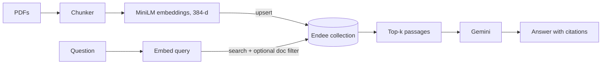

# Endee RAG Q&A

Ask questions over a set of research papers and get answers with page-level
citations, using **Endee** as the vector database.

## 1. Problem & Overview
Reading long PDFs to find one detail is slow, and LLMs answer confidently
without sources. This project retrieves the most relevant passages from a
document set using Endee and has an LLM answer **only from those passages**,
citing the file and page for each claim.

Demo corpus: 5 public arXiv papers (RAG, HNSW, Sentence-BERT, DPR, Transformer).

## 2. System Design

- **Ingestion:** PDF pages are split into overlapping word chunks, embedded
  with `all-MiniLM-L6-v2` and upserted in batches.
- **Retrieval:** the query is embedded and searched in Endee. An optional
  filter restricts results to one document.
- **Generation:** Gemini receives the numbered passages and must cite them.
- **Interface:** FastAPI backend (`/ask`, `/documents`) and a Streamlit UI that
  shows the answer and the source passages.

## 3. How Endee Is Used
- **Collection:** one dense `vector` field, `dimension=384`,
  `space_type=cosine`, `precision=int8`.
- **Upsert:** each object has `id`, `meta` (text, source, page), a `filter`
  tag (`doc`) and the embedding in `fields`.
- **Search:** `collection.search(fields={"embedding": {"query": vec, "limit": k}})`
  returns per-field ranked hits with similarity, meta and filter.
- **Filtering:** `filter=[{"doc": {"$eq": "<file>.pdf"}}]` scopes a question
  to one paper.
- **Experiments:** a separate collection per chunk size
  (`docs_c100`, `docs_c150`, `docs_c200`) for the comparison below.

## 4. Evaluation
12 hand-written questions over the 5 papers. A **hit** means a top-k chunk from
the correct paper contains the expected answer phrase (matching ignores
whitespace and hyphens, because PDF extraction breaks words across lines).
Latency is the Endee `search` call only (query already embedded), local server.

**Chunk size (top_k = 5)**

| Chunk (words) | Hit@1 | Hit@3 | Hit@5 | MRR | p50 ms | p95 ms |
|---|---|---|---|---|---|---|
| 100 | 0.17 | 0.58 | 0.83 | 0.41 | 50 | 57 |
| 150 | 0.42 | 0.67 | 0.83 | 0.57 | 49 | 51 |
| 200 | 0.33 | 0.83 | 0.83 | 0.51 | 50 | 52 |

**top_k (chunk size 150)**

| top_k | Hit@k | p50 ms |
|---|---|---|
| 1 | 0.42 | 49 |
| 3 | 0.67 | 48 |
| 5 | 0.83 | 48 |
| 10 | 0.92 | 48 |
| 20 | 1.00 | 48 |

**Findings**
- 150-word chunks gave the best Hit@1 and MRR in this sample. Differences
  between sizes are 1 to 3 questions, so treat them as indicative only.
- Both questions that missed at k=5 ("how are layers assigned in HNSW",
  "what attention function does the Transformer use") had the right chunk
  indexed but ranked 9th and 15th: the question wording differs from the
  paper's wording, which a small embedding model handles poorly.
- Search latency stayed flat as `top_k` grew (small local index).
- The embedding model reads at most 256 tokens, so chunks above about 190
  words are partly ignored. This is why 400-word chunks were not tested.

**Limitations:** 12 questions, keyword-based relevance, one embedding model,
small corpus. Next steps: hybrid dense + sparse search (supported by Endee) or
a reranker to fix wording mismatches, and a larger question set.

## 5. Setup & Run
**Requirements:** Python 3.12+, Docker, a Gemini API key.

1. **Endee server** (Linux/WSL2 with Docker):
   `curl -fsSL https://endee.io/install.sh | bash`, set a root token, then
   activate the free trial license in the web UI at `http://localhost:8081`.
2. **Project:**
   ```bash
   cd projects/endee-rag-qa
   python -m venv .venv && source .venv/bin/activate   # Windows: .venv\Scripts\Activate.ps1
   pip install -r requirements.txt
   cp .env.example .env    # fill in the values
   ```
3. **Create a database token** (once): run `python smoke_test.py`, copy the
   printed token into `.env` as `ENDEE_DB_TOKEN`.
4. **Ingest and run:**
   ```bash
   python -m app.ingest data --chunk 150 --overlap 30 --collection docs_c150
   uvicorn app.api:app
   streamlit run ui/streamlit_app.py
   ```
5. **Reproduce the evaluation:** build `docs_c100`, `docs_c150`, `docs_c200`
   with `app.ingest`, then `python -m eval.run_eval` and
   `python -m eval.topk_sweep`.

## 6. Demo


## 7. Project Structure
```
app/   config, chunking, ingest, retriever, llm, rag, api
ui/    streamlit_app.py
eval/  questions.json, run_eval.py, topk_sweep.py, diagnose.py
data/  source PDFs
```